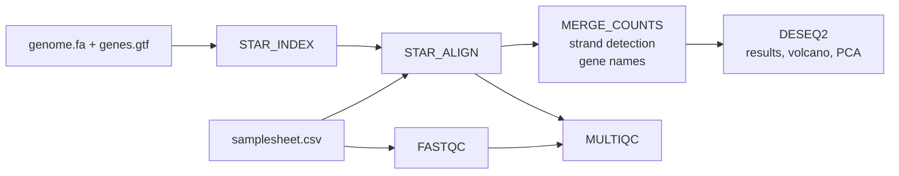

# LUAD RNA-seq pipeline (Nextflow)

[](https://github.com/AKULA-PRASAD/luad-rnaseq-nextflow/actions/workflows/ci.yml)

A Nextflow DSL2 pipeline that takes raw RNA-seq reads to a differential-expression result: **FASTQ → FastQC → STAR alignment and gene counts → count matrix → DESeq2 → MultiQC**.

It rebuilds, as a reproducible workflow, an analysis I first ran as individual SLURM jobs on Northeastern's HPC cluster in February 2026: lung adenocarcinoma tumour vs adjacent normal tissue, SRA study **SRP012656** (12 samples, 27 bp single-end reads, GRCh38 / GENCODE v44).



## Quick start (test data, about 2 minutes)

```bash
nextflow run main.nf -profile test,docker      # or -profile test,conda / test,singularity
python3 tests/check_outputs.py results_test    # compares the result with the planted truth
```

The test profile runs the whole pipeline on a small synthetic dataset (`tests/make_test_data.py`): one 52 kb chromosome with 40 genes, and 6 samples of 27 bp unstranded reads. Ten genes have planted changes: 5 up and 5 down 8-fold in Tumor. The check passes only if:
- all 10 planted genes are significant, with the right direction and log2 fold change;
- at most 2 of the 30 unchanged genes are called significant;
- the library is detected as unstranded;
- every expected output exists.

GitHub Actions runs this on every push, on two Nextflow versions.

## Running the real study on an HPC cluster

Written for Northeastern's Explorer cluster (SLURM, Apptainer). Compute nodes there have no internet access, so downloads happen on the login node first.

```bash
P=/scratch/$USER/luad; mkdir -p $P/{sra,fastq,ref,logs,containers}; cd $P

# 1. Login node: download the 12 runs, the GENCODE v44 reference and the containers
module load sratoolkit/12Dec2024
for r in SRR5021{27..38}; do prefetch $r -O sra --max-size 60G; done
G=https://ftp.ebi.ac.uk/pub/databases/gencode/Gencode_human/release_44
(cd ref && wget $G/GRCh38.primary_assembly.genome.fa.gz $G/gencode.v44.primary_assembly.annotation.gtf.gz)
cd containers
for img in fastqc:0.12.1--hdfd78af_0 star:2.7.11b--h5ca1c30_8 python:3.12.12 \
           bioconductor-deseq2:1.46.0--r44he5774e6_1 multiqc:1.33--pyhdfd78af_0; do
  apptainer pull --name "quay.io-biocontainers-${img/:/-}.img" "docker://quay.io/biocontainers/$img"
done
cd ..

# 2. Compute nodes: SRA -> FASTQ (array job), a quick test, then the full pipeline
sbatch ~/luad-rnaseq-nextflow/hpc/fastq_array.sbatch
sbatch ~/luad-rnaseq-nextflow/hpc/run_test.sbatch
sbatch --dependency=afterok:<fastq_job_id> ~/luad-rnaseq-nextflow/hpc/run_pipeline.sbatch
```

- **`run_pipeline.sbatch`** runs the Nextflow head process with `-profile explorer`. Each pipeline step is then submitted as its own SLURM job.
- **Why a cluster profile:** on Explorer, the STAR biocontainer crashed with `Illegal instruction` on several CPU types, even when a conservative build was forced. The `explorer` profile (`conf/explorer.config`) therefore runs the two STAR steps with the cluster's own `star/2.7.11b` module; all other steps stay in their pinned containers.
- **Resources:** STAR uses 8 CPUs and 42 GB per task, as in the original run.
- **Queue:** `--slurm_queue` sets the partition (default `short`).
- **Existing index:** to reuse a STAR index you already built, pass `--star_index /path/to/index` instead of `--genome`.

## Parameters

| Parameter | Default | Meaning |
|---|---|---|
| `--samplesheet` | required | CSV with `sample,condition,fastq_1[,fastq_2]`. Relative paths are resolved against the samplesheet's folder |
| `--genome`, `--gtf` | required | Reference FASTA and GTF (plain or `.gz`) |
| `--star_index` | none | Prebuilt STAR index (skips index building) |
| `--sjdb_overhang` | 26 | Read length − 1 |
| `--sa_index_nbases` | 14 | STAR `--genomeSAindexNbases` (14 for human) |
| `--strandedness` | auto | `auto`, `unstranded`, `forward` or `reverse` |
| `--star_simd` | none | Containers only: force one STAR build (`sse4.1`, `avx`, `avx2`). Use on clusters with mixed CPU types, where the container's automatic choice can crash with `Illegal instruction` |
| `--reference_level` | Normal | DESeq2 reference condition |
| `--padj` | 0.05 | Significance threshold (Benjamini–Hochberg) |
| `--outdir` | results | Output folder |

Profiles:
- `docker`, `singularity`, `apptainer`, `conda`: software;
- `slurm`: cluster execution;
- `explorer`: Northeastern Explorer (SLURM, Apptainer, cluster STAR module);
- `test`: bundled data.

Profiles can be combined, for example `-profile slurm,singularity`.

## Outputs

| Folder | Contents |
|---|---|
| `fastqc/` | per-sample read QC |
| `star/` | sorted BAM, alignment log and `ReadsPerGene.out.tab` per sample |
| `counts/` | `counts_matrix.csv` (gene id, gene name, one column per sample) and `strandedness.tsv` |
| `deseq2/` | `deseq2_results.csv` (all genes), `significant_genes.csv`, `summary.txt`, `volcano.pdf`, `pca.pdf` |
| `multiqc/` | one HTML report for FastQC and STAR |
| `pipeline_info/` | Nextflow timeline, resource report and trace |

## Design decisions

- **Strandedness is detected, not guessed.** STAR reports unstranded, forward and reverse counts. `MERGE_COUNTS` compares the gene-assigned totals of the two stranded columns:
  - one strand holds ≥ 80 % → stranded;
  - neither strand above 60 % → unstranded;
  - in between → unstranded, with a warning.

  It also writes the per-sample `N_noFeature` values that I checked by hand in the original run.
- **Gene names come from the GTF,** so result tables are readable without a separate ID-mapping step. That step was a listed limitation of the original analysis.
- **Same tool versions as the original run:** STAR 2.7.11b, FastQC 0.12.1, MultiQC 1.33 and DESeq2 1.46.0 (R 4.4), pinned per process for both containers and conda.
- **No adapter trimming,** as in the original: FastQC adapter content passed for all 12 samples, and STAR soft-clips read ends.
- **Each step is a separate module** (`modules/`) with its own software pinning, so steps can be reused or replaced independently.

## Original HPC analysis (February 2026)

These numbers come from my original SLURM-script run, **not yet from this pipeline**:
- **DESeq2 result:** 6,386 genes at padj < 0.05.
- **Strongest changes:** loss of alveolar markers in tumours, for example AGER (log2FC −4.10) and the surfactant genes SFTPC, SFTPA1 and SFTPA2.
- **Enrichr:** the top genes were linked to NKX2-1 targets and H3K27me3-marked genes.

Re-running the full study with this pipeline is the next step (see `Status`).

## Status

- **Pipeline:** complete. The test profile passes in CI (Linux, Docker).
- **Full 12-sample rerun:** pending, on HPC. When done, the results will be compared with the original run above and reported here.

## Limitations

- 27 bp reads limit unique mapping and splice-junction detection.
- 6 samples per group.
- Bulk RNA-seq cannot separate cell types.
- On Apple Silicon Macs:
  - the arm64 conda build of STAR 2.7.11b fails to read its own gene annotation during `--quantMode GeneCounts`, so the `conda` profile cannot run the STAR steps there;
  - use Docker with Rosetta instead (for example `colima start --vm-type vz --vz-rosetta`) and add `-process.containerOptions '--platform linux/amd64'`;
  - Linux machines (HPC, CI) need no workaround.

## Licence

MIT. Author: Prasad Akula.
