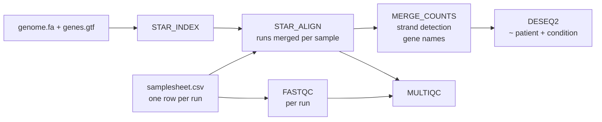

# LUAD RNA-seq pipeline (Nextflow)

[](https://github.com/AKULA-PRASAD/luad-rnaseq-nextflow/actions/workflows/ci.yml)

A Nextflow DSL2 pipeline that takes raw RNA-seq reads to a differential-expression result: **FASTQ → FastQC → STAR alignment and gene counts → count matrix → DESeq2 (R) → MultiQC**.

**Study:** lung adenocarcinoma tumour vs matched normal lung tissue from 6 never-smoker women, GEO **GSE37764** (SRA SRP012656; Kim et al., *PLoS One* 2013, PMID 23405175).
- **Sequencing:** 2 × 78 bp paired-end Illumina reads, two sequencing runs per sample, 24 runs in total.
- **Reference:** GRCh38 with GENCODE v44 annotation.
- **Design:** `~ patient + condition`, so each tumour is compared with its own patient's normal tissue.



## Quick start (test data, a few minutes)

```bash
nextflow run main.nf -profile test,docker          # single-end, 6 samples
nextflow run main.nf -profile test_paired,docker   # paired-end, 2 runs per sample, ~ patient + condition
python3 tests/check_outputs.py results_test
python3 tests/check_outputs.py results_test_paired tests/data_paired/samplesheet.csv
```

Both test profiles use small synthetic data generated by `tests/make_test_data.py`: one 52 kb chromosome with 40 genes, 10 of which have planted 8-fold changes (5 up and 5 down in Tumor). The paired profile adds:
- 3 patients with a patient-specific expression effect;
- paired-end reads;
- two runs per sample.

A check passes only if:
- all 10 planted genes are significant, with the right direction and fold change;
- at most 2 of the 30 unchanged genes are called significant;
- runs are merged into one column per sample;
- the library is detected as unstranded;
- the DESeq2 design is the expected one.

GitHub Actions runs both profiles on every push, on two Nextflow versions. It also runs `nextflow lint`, and regenerates the test data to confirm that it is reproducible.

## Running the study on an HPC cluster

Written for Northeastern's Explorer cluster (SLURM, Apptainer). Compute nodes there have no internet access, so downloads happen on the login node first.

```bash
P=/scratch/$USER/luad; mkdir -p $P/{sra,fastq,ref,logs,containers}; cd $P

# 1. Login node: SRA runs (~71 GB), GENCODE v44 reference, containers
module load sratoolkit/12Dec2024
~/luad-rnaseq-nextflow/bin/fetch_sra.sh ~/luad-rnaseq-nextflow/assets/samplesheet_GSE37764.csv .
G=https://ftp.ebi.ac.uk/pub/databases/gencode/Gencode_human/release_44
(cd ref && wget $G/GRCh38.primary_assembly.genome.fa.gz $G/gencode.v44.primary_assembly.annotation.gtf.gz)
export APPTAINER_TMPDIR=/tmp/$USER-apptainer          # local disk: much faster than /scratch
cd containers
for img in fastqc:0.12.1--hdfd78af_0 star:2.7.11b--h5ca1c30_8 python:3.12.12 \
           bioconductor-deseq2:1.46.0--r44he5774e6_1 multiqc:1.33--pyhdfd78af_0; do
  apptainer pull --name "quay.io-biocontainers-${img/:/-}.img" "docker://quay.io/biocontainers/$img"
done
cd ..

# 2. Compute nodes: SRA -> FASTQ (24-task array job), then the pipeline
sbatch ~/luad-rnaseq-nextflow/hpc/fastq_array.sbatch
sbatch --dependency=afterok:<fastq_job_id> ~/luad-rnaseq-nextflow/hpc/run_pipeline.sbatch
```

- **`run_pipeline.sbatch`** runs the Nextflow head process with `-profile explorer --batch_column patient`. Each pipeline step is then submitted as its own SLURM job.
- **Why a cluster profile:** on Explorer, the STAR biocontainer crashed with `Illegal instruction` on several CPU types, even when a conservative build was forced. The `explorer` profile (`conf/explorer.config`) therefore runs the two STAR steps with the cluster's own `star/2.7.11b` module; all other steps stay in their pinned containers.
- **Resources:** STAR uses 8 CPUs and 42 GB per task.
- **Queue:** `--slurm_queue` sets the partition (default `short`).

## Parameters

| Parameter | Default | Meaning |
|---|---|---|
| `--samplesheet` | required | CSV, **one row per sequencing run**: `sample,condition,fastq_1[,fastq_2][,run][,<batch>]`. Rows sharing a `sample` are aligned together. Relative paths resolve against the samplesheet's folder |
| `--genome`, `--gtf` | required | Reference FASTA and GTF (plain or `.gz`) |
| `--star_index` | none | Prebuilt STAR index (skips index building) |
| `--sjdb_overhang` | 77 | Read length − 1 |
| `--sa_index_nbases` | 14 | STAR `--genomeSAindexNbases` (14 for human) |
| `--strandedness` | auto | `auto`, `unstranded`, `forward` or `reverse` |
| `--batch_column` | none | Samplesheet column added to the DESeq2 design, for example `patient` for matched pairs: `~ batch + condition` |
| `--reference_level` | Normal | DESeq2 reference condition |
| `--padj` | 0.05 | Significance threshold (Benjamini–Hochberg) |
| `--star_simd` | none | Containers only: force one STAR build (`sse4.1`, `avx`, `avx2`) |
| `--outdir` | results | Output folder |

Profiles:
- `docker`, `singularity`, `apptainer`, `conda`: software;
- `slurm`: cluster execution;
- `explorer`: Northeastern Explorer;
- `test`, `test_paired`: bundled data.

## Outputs

| Folder | Contents |
|---|---|
| `fastqc/` | read QC per run and mate |
| `star/` | sorted BAM, alignment log and `ReadsPerGene.out.tab` per sample |
| `counts/` | `counts_matrix.csv` (gene id, gene name, one column per sample) and `strandedness.tsv` |
| `deseq2/` | `deseq2_results.csv` (all genes), `significant_genes.csv`, `summary.txt` (including the design), `volcano.pdf`, `pca.pdf` |
| `multiqc/` | one HTML report for FastQC and STAR |
| `pipeline_info/` | Nextflow timeline, resource report and trace |

## Design decisions

- **Strandedness is detected, not guessed.** STAR reports unstranded, forward and reverse counts. `MERGE_COUNTS` compares the gene-assigned totals of the two stranded columns:
  - one strand holds ≥ 80 % → stranded;
  - neither strand above 60 % → unstranded;
  - in between → unstranded, with a warning.
- **Gene names come from the GTF,** so result tables never depend on a separate, error-prone ID-to-symbol mapping step.
- **Runs are merged at alignment, not after counting.** STAR receives all runs of a sample as comma-separated lists, so each sample gets one BAM file and one count column.
- **Matched design:** tumour and normal tissue come from the same patients, so `patient` enters the model.
- **Pinned versions:** STAR 2.7.11b, FastQC 0.12.1, MultiQC 1.33 and DESeq2 1.46.0 (R 4.4), pinned per process for both containers and conda.
- **Each step is a separate module** (`modules/`), so steps can be reused or replaced independently.

## Data provenance note

An earlier version of this analysis, run as separate SLURM scripts in February 2026, used SRA runs SRR502127–SRR502138, believing them to be this study's RNA-seq.
- **What the runs actually are:** while rebuilding the workflow I checked each run against NCBI's records, and found they are ENCODE **ChIP-seq** of the K562 and GM12878 cell lines (SRA SRP007993), not lung tissue.
- **The rebuilt pipeline reproduced that earlier run exactly** (identical per-gene counts and DESeq2 estimates). The earlier error was the run list, not the processing.
- **Symptoms in that output:**
  - about 60 % of reads mapped outside genes;
  - lung markers were almost absent;
  - the top "differences" clustered on 9q34 and 22q11, the BCR-ABL amplicon of K562.
- **The earlier biological conclusions are withdrawn.**
- **The fix:** this repository uses the correct 24 runs, taken directly from the GEO/SRA records (`assets/samplesheet_GSE37764.csv`, which includes the GSM accession of each run).

## Status

- **Pipeline:** complete. Both test profiles pass in CI (Linux, Docker).
- **GSE37764 on HPC:** in progress. Results will be added here when the run is complete.

## Limitations

- 6 patients: enough for strong effects, limited power for small ones.
- Bulk RNA-seq cannot separate cell types. Tumour–normal differences mix changes in cell composition with changes in gene regulation.
- On Apple Silicon Macs:
  - the arm64 conda build of STAR 2.7.11b fails during `--quantMode GeneCounts`, so the `conda` profile cannot run the STAR steps there;
  - use Docker with Rosetta instead (`colima start --vm-type vz --vz-rosetta`) and add `-process.containerOptions --platform=linux/amd64`.

## Licence

MIT. Author: Prasad Akula.
