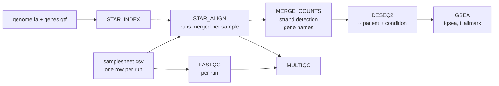
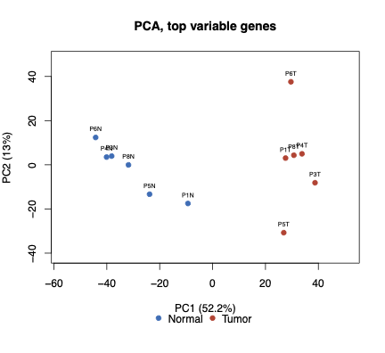
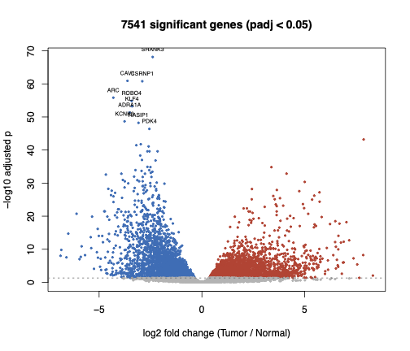
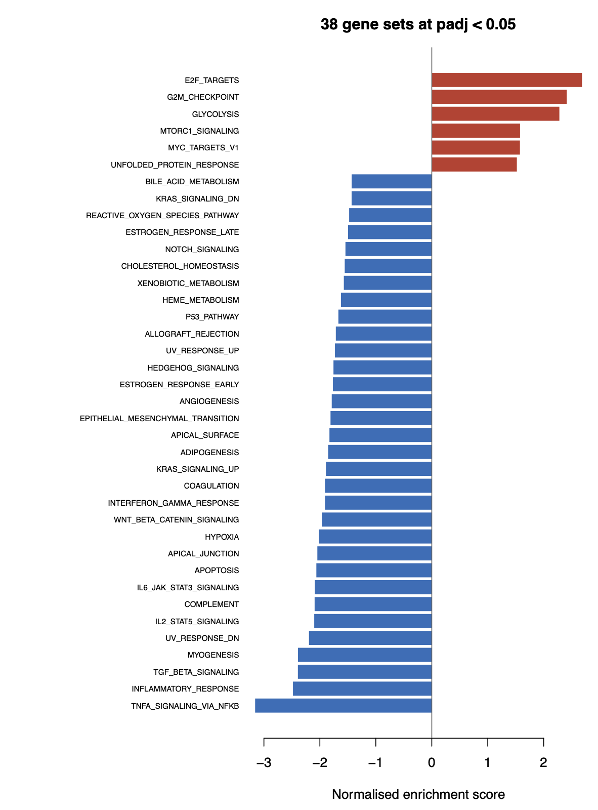

# LUAD RNA-seq pipeline (Nextflow)

[](https://github.com/AKULA-PRASAD/luad-rnaseq-nextflow/actions/workflows/ci.yml)


A Nextflow DSL2 pipeline that takes raw RNA-seq reads to a differential-expression result:

**FASTQ → FastQC → STAR alignment and gene counts → count matrix → DESeq2 (R) → gene set enrichment (fgsea) → MultiQC**

It is applied here to lung adenocarcinoma (LUAD) tumours and matched normal lung tissue, and is tested on every change against synthetic data with known answers.

## Objective

Find the genes, and the biological programmes, whose expression differs between lung adenocarcinoma and the adjacent normal lung of the same patient. Do this with a workflow that anyone can rerun from public data and get the same numbers.

## Dataset

| | |
|---|---|
| Study | Kim et al., *PLoS One* 2013 (PMID [23405175](https://pubmed.ncbi.nlm.nih.gov/23405175/)) |
| Accessions | GEO [GSE37764](https://www.ncbi.nlm.nih.gov/geo/query/acc.cgi?acc=GSE37764); SRA SRP012656 |
| Samples | 6 never-smoker Korean women with non-small-cell lung cancer (patients P1, P3, P4, P5, P6, P8); tumour and matched normal tissue for each, 12 samples |
| Sequencing | Illumina, 2 × 78 bp paired-end; 2 runs per sample, 24 runs (SRR493937–SRR493960), about 71 GB |
| Reference | GRCh38 primary assembly, GENCODE v44 primary annotation |

[`assets/samplesheet_GSE37764.csv`](assets/samplesheet_GSE37764.csv) lists every run together with its sample, patient, condition and GSM accession. The list was taken from the GEO/SRA records (see [Data provenance](#data-provenance)).

## Pipeline



| Step | Tool | What it does |
|---|---|---|
| `FASTQC` | FastQC 0.12.1 | Read quality report for each run and mate |
| `STAR_INDEX` | STAR 2.7.11b | Genome index with splice junctions from the GTF (built once) |
| `STAR_ALIGN` | STAR 2.7.11b | Spliced alignment of all runs of a sample together. Gene counts are made in the same pass (`--quantMode GeneCounts`) |
| `MERGE_COUNTS` | Python 3.12 (standard library) | Builds the gene × sample matrix, detects strandedness and adds gene names from the GTF |
| `DESEQ2` | DESeq2 1.46.0 (R 4.4) | Median-of-ratios normalisation, Wald test, Benjamini–Hochberg; volcano plot and PCA |
| `GSEA` | fgsea 1.32.2 (R 4.4) | Pre-ranked enrichment of the MSigDB Hallmark gene sets on the DESeq2 Wald statistic |
| `MULTIQC` | MultiQC 1.33 | One HTML report combining FastQC and STAR statistics |

Each tool version is pinned per process, both as a biocontainer image and as a conda package. Every run also records the versions actually used in `pipeline_info/software_versions.yml`.

## Installation

**Requirements**
- Java 17 or later.
- [Nextflow](https://www.nextflow.io/) 24.04 or later. CI tests 24.10.5 and 25.04.8.
- One of: Docker, Apptainer/Singularity, or conda.

```bash
curl -s https://get.nextflow.io | bash && mv nextflow ~/bin/   # or: conda install -c bioconda nextflow
git clone https://github.com/AKULA-PRASAD/luad-rnaseq-nextflow.git
cd luad-rnaseq-nextflow
```

There is nothing else to install: each step pulls its own pinned container, or builds its own conda environment.

## Quick start: test data (a few minutes, laptop)

```bash
nextflow run main.nf -profile test,docker          # single-end, 6 samples
nextflow run main.nf -profile test_paired,docker   # paired-end, 3 patients, 2 runs per sample, ~ patient + condition
python3 tests/check_outputs.py results_test
python3 tests/check_outputs.py results_test_paired tests/data_paired/samplesheet.csv
```

**What the test data contains.** `tests/make_test_data.py` writes a deterministic synthetic dataset:
- one 52 kb chromosome with 40 genes;
- 10 of the genes have a planted 8-fold change (5 up and 5 down in Tumor);
- the paired profile adds 3 patients with patient-specific expression, paired-end reads, and two runs per sample.

**When a test passes.** A check passes only if:
- all 10 planted genes are significant, with the right direction and a fold change within 1 log2 unit;
- GSEA finds the planted up-set and down-set in the right direction, and not the null set;
- every tool version is recorded;
- at most 2 of the 30 unchanged genes are called significant;
- runs are merged into one column per sample;
- the library is detected as unstranded;
- the DESeq2 design is the expected one.

**nf-test.** The repository also has an [nf-test](https://www.nf-test.com/) suite of 10 tests: one or more per module, plus whole-pipeline tests.

```bash
nf-test test                                   # all tests
nf-test test --tag modules                     # module tests only, under a minute
NFT_PLATFORM=linux/amd64 nf-test test          # on Apple Silicon (amd64 containers under Rosetta)
```

Module tests run each process alone on small inputs. They check:
- that STAR reproduces the committed per-gene counts;
- that DESeq2 finds exactly the planted genes;
- that GSEA calls the planted gene sets in the right direction.

The pipeline tests run both synthetic datasets end to end, and check that a samplesheet listing a FASTQ twice is rejected. Outputs that should never change are compared with snapshots committed in `tests/`.

## Running on your own data

```bash
nextflow run main.nf -profile docker \
    --samplesheet samplesheet.csv --genome genome.fa.gz --gtf genes.gtf.gz \
    --sjdb_overhang <read length - 1> --batch_column patient --outdir results
```

The samplesheet has **one row per sequencing run**:

```csv
sample,patient,condition,run,fastq_1,fastq_2
P1N,P1,Normal,SRR493937,fastq/SRR493937_1.fastq.gz,fastq/SRR493937_2.fastq.gz
P1N,P1,Normal,SRR493938,fastq/SRR493938_1.fastq.gz,fastq/SRR493938_2.fastq.gz
```

- Rows that share a `sample` are aligned together.
- Relative paths resolve against the samplesheet's folder.
- The pipeline stops before any work starts if a row lacks `sample`, `condition` or `fastq_1`, or if a FASTQ file or run is listed twice.
- It also stops if one sample's rows disagree on condition or batch, or mix single-end and paired-end reads.

### Parameters

| Parameter | Default | Meaning |
|---|---|---|
| `--samplesheet` | required | CSV as above: `sample,condition,fastq_1[,fastq_2][,run][,<batch>]` |
| `--genome`, `--gtf` | required | Reference FASTA and GTF (plain or `.gz`) |
| `--star_index` | none | Prebuilt STAR index (skips index building) |
| `--sjdb_overhang` | 77 | Read length − 1 |
| `--sa_index_nbases` | 14 | STAR `--genomeSAindexNbases` (14 for human) |
| `--strandedness` | auto | `auto`, `unstranded`, `forward` or `reverse` |
| `--batch_column` | none | Samplesheet column added to the DESeq2 design, for example `patient` for matched pairs: `~ batch + condition` |
| `--reference_level` | Normal | DESeq2 reference condition |
| `--padj` | 0.05 | Significance threshold (Benjamini–Hochberg), used by DESeq2 and GSEA |
| `--gsea_gmt` | Hallmark (bundled) | Gene sets in GMT format, with gene symbols matching the GTF's `gene_name` |
| `--gsea_min_size`, `--gsea_max_size` | 15, 500 | Gene-set size limits after matching to the ranked genes |
| `--skip_gsea` | false | Skip the enrichment step |
| `--star_simd` | none | Containers only: force one STAR build (`sse4.1`, `avx`, `avx2`) |
| `--outdir` | results | Output folder |

### Profiles

| Profile | Use |
|---|---|
| `docker`, `singularity`, `apptainer`, `conda` | Software provisioning |
| `slurm` | Generic SLURM cluster: one job per pipeline step |
| `explorer` | Northeastern Explorer: one job per step; STAR from the cluster module |
| `explorer_node` | Northeastern Explorer: every step inside one 16-CPU allocation (used for the results below) |
| `test`, `test_paired` | Bundled synthetic data |

## Running the full study on an HPC cluster

The scripts in `hpc/` are written for Northeastern's Explorer cluster (SLURM, Apptainer). Compute nodes there have no internet access, so all downloads happen on the login node.

```bash
P=/scratch/$USER/luad; mkdir -p $P/{sra,fastq,ref,logs,containers}; cd $P

# 1. Login node: SRA runs (~71 GB), GENCODE v44 reference, containers
module load sratoolkit/12Dec2024
~/luad-rnaseq-nextflow/bin/fetch_sra.sh ~/luad-rnaseq-nextflow/assets/samplesheet_GSE37764.csv .
G=https://ftp.ebi.ac.uk/pub/databases/gencode/Gencode_human/release_44
(cd ref && wget $G/GRCh38.primary_assembly.genome.fa.gz $G/gencode.v44.primary_assembly.annotation.gtf.gz)
export APPTAINER_TMPDIR=/tmp/$USER-apptainer          # local disk: much faster than /scratch
cd containers
for img in fastqc:0.12.1--hdfd78af_0 star:2.7.11b--h5ca1c30_8 python:3.12.12 \
           bioconductor-deseq2:1.46.0--r44he5774e6_1 multiqc:1.33--pyhdfd78af_0; do
  apptainer pull --name "quay.io-biocontainers-${img/:/-}.img" "docker://quay.io/biocontainers/$img"
done
cd ..

# 2. Compute nodes: SRA -> FASTQ (24-task array job), then the whole pipeline in one allocation
J=$(sbatch --parsable ~/luad-rnaseq-nextflow/hpc/fastq_array.sbatch)
sbatch --dependency=afterok:$J ~/luad-rnaseq-nextflow/hpc/run_pipeline_node.sbatch
```

**Three Explorer issues the scripts work around:**
1. **STAR crashes in the container.** The STAR biocontainer crashed with `Illegal instruction` on several Explorer CPU types, so both Explorer profiles run the two STAR steps with the cluster's `star/2.7.11b` module.
2. **Refused job submissions.** On some days the scheduler refused submissions intermittently (`sbatch: ... Unexpected message received`). With one job per step (`run_pipeline.sbatch`, profile `explorer`), a single refusal stops the run. `run_pipeline_node.sbatch` (profile `explorer_node`) needs only one submission, so it avoids the problem.
3. **FastQC crashes when run in parallel.** Parallel FastQC tasks in separate containers can share the host `/tmp` and collide on the Java monitoring file (`SIGBUS`). The FastQC step turns that file off (`-XX:-UsePerfData`).

## Outputs

| Folder | Contents |
|---|---|
| `fastqc/` | Read QC per run and mate |
| `star/` | Sorted BAM, alignment log and `ReadsPerGene.out.tab` per sample |
| `counts/` | `counts_matrix.csv` (gene id, gene name, one column per sample) and `strandedness.tsv` |
| `deseq2/` | `deseq2_results.csv` (all genes), `significant_genes.csv`, `summary.txt` (including the design), `volcano.pdf`, `pca.pdf` |
| `gsea/` | `gsea_results.tsv` (NES, p, padj and leading-edge genes per set), `gsea_summary.txt`, `gsea_nes.pdf` |
| `multiqc/` | One HTML report for FastQC and STAR |
| `pipeline_info/` | Nextflow timeline, resource report, trace and `software_versions.yml` |

## Results: GSE37764

All 24 runs went through the pipeline on the Explorer cluster in one 16-CPU, 100 GB allocation (profile `explorer_node`):
- the first full run took 3 h 16 min, including building the STAR index;
- a second, from-scratch run of release 1.0.0, reusing the index, took 2 h 18 min. All 40 tasks succeeded.

The files in [`docs/`](docs/) are copied from these runs' output. Tool versions for the 1.0.0 run: [`docs/software_versions_GSE37764.yml`](docs/software_versions_GSE37764.yml).

### Read QC and alignment

| Sample | Read pairs | Uniquely mapped | Multi-mapped | Pairs assigned to genes |
|---|---:|---:|---:|---:|
| P1N | 77.0 M | 87.0 % | 6.4 % | 53.7 M (69.7 %) |
| P1T | 68.0 M | 87.1 % | 7.1 % | 45.0 M (66.2 %) |
| P3N | 68.7 M | 92.3 % | 4.6 % | 52.7 M (76.7 %) |
| P3T | 82.6 M | 84.2 % | 6.2 % | 55.8 M (67.5 %) |
| P4N | 71.6 M | 88.6 % | 4.6 % | 51.2 M (71.5 %) |
| P4T | 68.4 M | 86.0 % | 5.7 % | 47.0 M (68.8 %) |
| P5N | 68.5 M | 82.7 % | 4.5 % | 46.3 M (67.6 %) |
| P5T | 58.4 M | 84.8 % | 7.8 % | 39.5 M (67.7 %) |
| P6N | 54.0 M | 87.2 % | 4.1 % | 39.0 M (72.3 %) |
| P6T | 59.0 M | 88.2 % | 4.6 % | 40.6 M (68.8 %) |
| P8N | 62.7 M | 86.8 % | 3.5 % | 44.2 M (70.5 %) |
| P8T | 63.8 M | 86.3 % | 4.6 % | 42.2 M (66.1 %) |

- **Each sample combines two runs.** Data: [`docs/qc_summary_GSE37764.tsv`](docs/qc_summary_GSE37764.tsv). Full report: [`docs/multiqc_report_GSE37764.html`](docs/multiqc_report_GSE37764.html) (download it and open it in a browser).
- **The library is unstranded:** the two strands each held 50.0 % of gene-assigned reads, so the unstranded count column was used.
- **FastQC (48 files: 24 runs × 2 mates):**
  - all reads are 78 bp, with 51–54 % GC;
  - *Per base sequence content* fails in every file. This is normal for RNA-seq, because random-hexamer priming biases the first bases of each read.
  - *Sequence duplication* warns in 47 files. This is also expected for RNA-seq, since highly expressed genes produce many identical reads.
  - The weakest files are read 2 of patient P8's four runs (SRR493957–SRR493960). There, the mean base quality falls to Q15–17 at the 3′ end. Reads were not trimmed: STAR soft-clips poor read ends, and P8's samples still mapped 86–87 % uniquely.

### Sample structure

PCA of the 500 most variable genes (variance-stabilised counts):
- PC1 explains 52 % of the variance and separates all 6 tumours from all 6 normal samples;
- tumours spread more widely than normal samples along PC2.



### Differential expression

Design `~ patient + condition`, so each tumour is compared with its own patient's normal tissue. Benjamini–Hochberg correction.
- 7,541 genes at padj < 0.05: 3,760 higher and 3,781 lower in tumour.
- 5,299 of them also change at least 2-fold (|log2FC| ≥ 1).
- 62,754 genes were tested, and 31,293 passed DESeq2's independent filtering and received an adjusted p-value. Summary: [`docs/deseq2_summary_GSE37764.txt`](docs/deseq2_summary_GSE37764.txt).



### Known lung biology recovered

| Group | Genes (log2 fold change, tumour vs normal) |
|---|---|
| Normal lung, lower in tumour | AGER −4.6, CA4 −6.1, CLDN18 −3.8, CAV1 −3.6, SFTPC −3.2, TEK −2.8, ADH1B −2.7, PECAM1 −2.1 |
| Higher in tumour | CEACAM5 +5.5, SPP1 +5.8, MMP11 +5.1, COL11A1 +5.1, GREM1 +4.5, TOP2A +2.8, MKI67 +1.9 |
| Unchanged | NKX2-1 +0.1, NAPSA +0.1 |

All listed changes have padj < 10⁻⁴ (largest: MKI67, 2 × 10⁻⁵).

**How to read this:**
- The losses mark normal alveolar and capillary tissue: type I and II pneumocytes (AGER, SFTPC, CLDN18) and lung capillary endothelium (CA4, TEK, PECAM1).
- The gains are typical of tumours: proliferation (TOP2A, MKI67) and tumour stroma or invasion (COL11A1, MMP11, SPP1).
- NKX2-1 and NAPSA are lung-lineage markers that adenocarcinomas usually keep, so no change is the expected result.

### Pathway enrichment (Hallmark GSEA)

Pre-ranked GSEA (fgsea 1.32.2) on the DESeq2 Wald statistic of the 31,135 named genes with an adjusted p-value, against the 50 MSigDB Hallmark gene sets.
- 38 of 50 sets reach padj < 0.05: 6 enriched in tumour, 32 enriched in normal tissue.
- Full table: [`docs/gsea_results_GSE37764.tsv`](docs/gsea_results_GSE37764.tsv).

| Direction | Hallmark set (normalised enrichment score) |
|---|---|
| Higher in tumour | E2F targets 2.69, G2M checkpoint 2.41, glycolysis 2.28, mTORC1 signalling 1.58, MYC targets v1 1.58, unfolded protein response 1.52 |
| Higher in normal tissue | TNF-α signalling via NF-κB −3.16, inflammatory response −2.48, TGF-β signalling −2.39, myogenesis −2.39, IL-6/JAK/STAT3 −2.09, complement −2.09, hypoxia −2.02, epithelial–mesenchymal transition −1.81 |



**How to read this:**
- **Tumour side:** the sets enriched in tumour describe cell division (E2F targets, G2M checkpoint), growth signalling (MYC, mTORC1) and glycolytic metabolism. This agrees with the gene-level gains in TOP2A and MKI67.
- **Normal side:** many sets enriched in normal tissue reflect what normal lung contains more of: blood vessels, smooth muscle, and immune and stromal cells. Examples are myogenesis, complement and the inflammatory sets.
- **Caution:** in bulk tissue these scores mix cell composition with gene regulation (see Limitations). For example, the immediate-early genes in the TNF-α/NF-κB set can also respond to tissue handling. The scores therefore show differences between tissues, not active pathways in tumour cells.

## Reproducibility

- **Pinned software:** every tool version is pinned per process, both as a container image and as a conda package.
- **Recorded inputs:** the run list is fixed in the samplesheet, and the reference is the stated GENCODE release.
- **Auditable runs:** Nextflow writes a timeline, a resource report and a per-task trace to `pipeline_info/`.
- **Resumable runs:** `-resume` reuses completed steps.
- **Tested on every push:** GitHub Actions ([`.github/workflows/ci.yml`](.github/workflows/ci.yml)) runs on two Nextflow versions and:
  - lints the code (`nextflow lint`, strict syntax);
  - runs 11 unit tests of the count-merging script (strandedness detection, GTF parsing, matrix assembly);
  - resolves every profile;
  - checks the scripts' syntax;
  - regenerates the synthetic data and confirms it matches the committed copy byte for byte (after decompression);
  - runs both test profiles in Docker and checks the results against the planted truth;
  - confirms that `-resume` uses the cache;
  - runs the nf-test suite. A changed or missing snapshot fails the build.
- **Reproduced on the cluster:** the 1.0.0 rerun of GSE37764 reproduced the first run:
  - an identical count matrix;
  - the same 7,541 significant genes;
  - log2 fold changes and adjusted p-values within 10⁻⁶ of the first run for all 62,754 genes.
- **Not repeated in CI:** the full GSE37764 run needs about 71 GB of input and a 42 GB STAR index, so CI does not rerun it. Its outputs are recorded in `docs/`.

## Design decisions

- **Strandedness is detected, not guessed.** STAR reports unstranded, forward and reverse counts. `MERGE_COUNTS` compares the gene-assigned totals of the two stranded columns:
  - one strand holds ≥ 80 % → stranded;
  - neither strand above 60 % → unstranded;
  - in between → unstranded, with a warning.
- **Gene names come from the GTF,** so result tables never depend on a separate, error-prone ID-to-symbol mapping step.
- **Runs are merged at alignment, not after counting.** STAR receives all runs of a sample as comma-separated lists, so each sample gets one BAM file and one count column.
- **Matched design:** tumour and normal tissue come from the same patients, so `patient` enters the model.
- **Each step is a separate module** (`modules/`), so steps can be reused or replaced independently.

## Data provenance

An earlier version of this analysis, run as separate SLURM scripts in February 2026, used SRA runs SRR502127–SRR502138, believing them to be this study's RNA-seq.
- **What the runs actually are:** while rebuilding the workflow I checked each run against NCBI's records, and found they are ENCODE **ChIP-seq** of the K562 and GM12878 cell lines (SRA SRP007993), not lung tissue.
- **The rebuilt pipeline reproduced that earlier run exactly** (identical per-gene counts and DESeq2 estimates). The error was in the run list, not the processing.
- **Symptoms in that output:**
  - most reads fell outside genes;
  - lung markers were almost absent;
  - the top "differences" clustered on 9q34 and 22q11, the BCR-ABL amplicon of K562.
- **The earlier biological conclusions are withdrawn.** This repository uses the 24 runs listed in the GEO record of GSE37764.

## Limitations

- **6 patients:** enough for strong effects, limited power for small ones.
- **Bulk tissue:** bulk RNA-seq cannot separate cell types. Tumour–normal differences mix changes in cell composition with changes in gene regulation.
- **Gene-level only:** the pipeline counts genes. It does not quantify transcripts or isoforms, and does no read trimming.
- **Human gene sets:** the bundled Hallmark sets use human gene symbols. For other species, pass `--gsea_gmt`, or use `--skip_gsea`.
- **Research use only:** these results have no clinical use.
- **Apple Silicon Macs:**
  - the arm64 conda build of STAR 2.7.11b fails during `--quantMode GeneCounts`, so the `conda` profile cannot run the STAR steps there;
  - use Docker with Rosetta instead (`colima start --vm-type vz --vz-rosetta`) and add `-process.containerOptions --platform=linux/amd64`.

## Citation

If you use this pipeline, please cite it with the metadata in [`CITATION.cff`](CITATION.cff) (GitHub's "Cite this repository" button). Please also cite the data and tools:

- **Data:** Kim SC, Jung Y, Park J, et al. A high-dimensional, deep-sequencing study of lung adenocarcinoma in female never-smokers. *PLoS One* 2013;8(2):e55596. doi:10.1371/journal.pone.0055596
- **Nextflow:** Di Tommaso P, et al. *Nat Biotechnol* 2017;35:316–319.
- **STAR:** Dobin A, et al. *Bioinformatics* 2013;29:15–21.
- **DESeq2:** Love MI, Huber W, Anders S. *Genome Biol* 2014;15:550.
- **FastQC:** Andrews S. FastQC (Babraham Bioinformatics).
- **MultiQC:** Ewels P, et al. *Bioinformatics* 2016;32:3047–3048.
- **GENCODE:** Frankish A, et al. *Nucleic Acids Res* 2023;51:D942–D949.
- **fgsea:** Korotkevich G, et al. *bioRxiv* 2021, doi:10.1101/060012.
- **MSigDB Hallmark gene sets:** Liberzon A, et al. *Cell Syst* 2015;1:417–425. Gene sets v2024.1.Hs, CC BY 4.0.

## Contributing and changes

See [`CONTRIBUTING.md`](CONTRIBUTING.md) for development setup and checks, and [`CHANGELOG.md`](CHANGELOG.md) for the release history.

## Licence

MIT © Prasad Akula. The bundled MSigDB Hallmark gene sets are distributed under CC BY 4.0.
